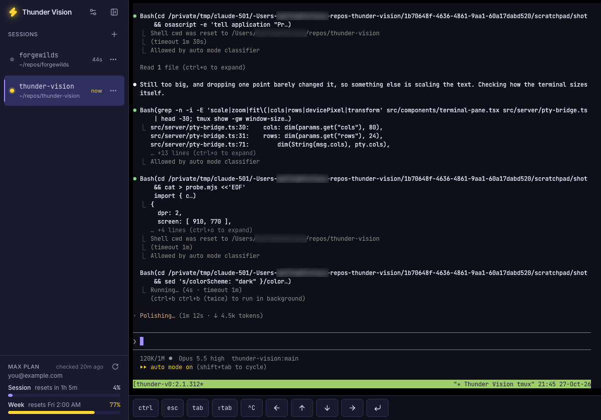

# ⚡ Thunder Vision

Your tmux sessions as browser tabs, over Tailscale. Drive long-running Claude
Code sessions from a desk, an iPad or a phone, no terminal app needed. Closing
the browser just detaches, so whatever's running keeps going.



## Features

- **Tabs are tmux sessions.** Sessions made anywhere show up within 2s, and the
  URL hash (`#my-app`) makes each one bookmarkable.
- **Busy dots** pulse while a session is printing, i.e. Claude is mid-turn.
- **New session palette** (⌘K): pick a folder, type a new name or path, or
  paste a git URL to clone. Optionally run a start command like `claude`.
- **Scheduled jobs**: run Claude (`claude -p`, often a custom slash command)
  or a shell command in a folder on a schedule. Green and red dots for recent
  runs, a live log, the final message, and "continue in session" to pick a
  run up in Claude. [Details](docs/jobs.md).
- **Plan usage** in the sidebar: your session and weekly caps, as `/usage`
  shows them. [How it works](docs/plan-usage.md).
- **Touch friendly.** A drawer sidebar on phones and a key bar with esc, tab,
  ctrl, arrows and the other keys iOS lacks. Drag a finger to scroll back
  (with momentum; tmux's `mouse on` needed), then **Back to live**.
- **Self-healing.** Terminals reconnect after a blip; pages reload when the
  server restarts.

| Keys    | Does                                            |
| ------- | ----------------------------------------------- |
| ⌘K, +   | New session (Tab on a row for name and command) |
| ⌥1 – ⌥9 | Jump to tab 1–9                                 |

Everything else goes to the terminal, tmux prefix keys included.

## Quick start

You need macOS ([or Linux](docs/configuration.md#linux)), Node 22+, pnpm, tmux,
git and [Tailscale](https://tailscale.com/download) on the host, and Tailscale
on each device you'll use.

```sh
brew install node pnpm tmux git
git clone https://github.com/Mandalorian007/thunder-vision && cd thunder-vision
pnpm install
cp .env.example .env          # optional settings, all commented out
pnpm dev                      # http://127.0.0.1:7700
```

**Put it on your tailnet.** Turn on MagicDNS and HTTPS certificates in
Tailscale's [DNS settings](https://login.tailscale.com/admin/dns). With the Mac
app, turn on its **Install CLI** setting so `tailscale` works in a terminal.
Then:

```sh
tailscale serve --bg --https=7700 http://127.0.0.1:7700
tailscale serve status        # must say "(tailnet only)"
```

Open `https://<machine>.<tailnet>.ts.net:7700` from any device on the tailnet.
On iOS, **Share → Add to Home Screen** makes it full-screen.

**Keep it running** with a launchd agent that starts at login. Stop
`pnpm dev` first (Ctrl-C), since they share the port:

```sh
./scripts/install-launchd.sh  # add `prod` after `pnpm build` for a stable build
```

For the plan usage meters, be logged in to Claude Code as the same user.
Settings, launchd and updating are in [configuration](docs/configuration.md).

## Security

This is a shell with no login of its own. Tailscale is the lock:

- It listens on `127.0.0.1` only, so `tailscale serve` is the way in. Anything
  that reaches the port gets a shell as you, including other accounts on a
  shared Mac.
- **Never use `tailscale funnel`**, which makes a port public.
- It answers only to `localhost` and `*.ts.net` names, and only to requests
  from its own pages, so other sites in your browser can't drive it. A raw
  Tailscale IP or LAN name gets `403 unknown host`.

## Docs

- [Configuration](docs/configuration.md): settings, launchd, updating
- [Scheduled jobs](docs/jobs.md): schedules, runs, timeouts, files
- [Plan usage](docs/plan-usage.md): where the numbers come from
- [Development](docs/development.md): architecture, API, workflow
- [Troubleshooting](docs/troubleshooting.md)

## License

MIT. See [LICENSE](LICENSE).
